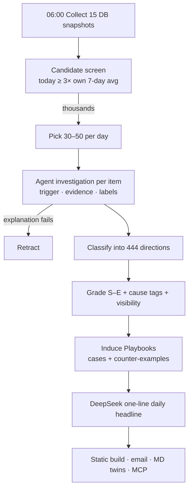

# Stringers.io Deep Teardown

> [!NOTE]
> **Research date:** 2026-11-18 · **Scope:** home feed, breakout detail pages, direction pages, archived long reports, playbooks, indie revenue stats, `llms.txt`, about/data page, and the public repo `komako-workshop/stringers`.
> **Purpose:** decide what to borrow before upgrading the Opportunity Loop radar.

## 0. Executive Summary

**Stringers answers one question every morning:** *which small products suddenly took off yesterday, why, and what can a team of 1–2 people copy?*

Five things make it work:

1. **Per-entity breakout rule.** A product qualifies when today's delta is at least 3× its *own* trailing 7-day average, not when it ranks high on a chart.
2. **One agent investigation per breakout.** It finds the dated trigger, labels every claim (fact, inference, not found), discounts its own numbers, and retracts items that don't hold up.
3. **A lesson-first editorial template.** The headline is the transferable play; the product name comes second.
4. **Induction into playbooks.** 25 plays backed by 110 products, each with real cases *and* counter-examples.
5. **An agent-native surface.** Every page has a Markdown twin, plus `llms.txt`, public JSON and a token-per-user MCP server.

> [!IMPORTANT]
> **Biggest signal:** on 2026-11-12 Stringers **froze its ~90 long "direction" reports** and moved the product to the daily *Market Pulse* + *Playbooks*. Our current "3–5 directions with full PRDs" format is the format they just retired.

---

## 1. Product Overview

| Item | Detail |
|---|---|
| Name | 什么值得做 / Stringers (`stringers.io`, English at `/en/`) |
| Launch stage | "v1 for friends", own data starts about 2026-10-28 (around 20 days of history) |
| Output volume | 30–50 investigated breakouts per day (439 in 11 days) |
| Coverage | 444 directions, 3,000+ graded products, 3,879 Product Hunt dossiers, 25 playbooks |
| Build | Fully static, 3,996 pages regenerated daily in about 70 seconds |
| Business model | Free during beta; email + WeChat group; MCP free tier at 200 queries/day |

### Site architecture

| Section | Path | Role |
|---|---|---|
| Market Pulse 市场动态 | `/` | Daily feed of investigated breakouts, grouped by date |
| Today's chart tops | `/today.html` | Top graded products per surface (App / GitHub / Chrome / Web) |
| Directions | `/dir/dNNN.html` | 444 category pages: recent breakouts + landscape stats |
| Breakout detail | `/news/<source>-<slug>.html` | The core investigation report |
| Rising products | `/apps/` `/github/` `/ext/` `/web/` | 3,000+ graded product cards |
| Breakout singles | `/hot/` | Curated "still exploding" products with verified revenue |
| Playbooks | `/plays/` | 25 induced tactics with evidence counts |
| Dossiers | `/p/` | Product Hunt picks, one agent-written file each |
| Indie revenue index | `/stats/indie-revenue.html` | SEO / citation magnet, recomputed daily |
| Data & tools | `/tools/` | The 15 databases + MCP onboarding |
| Archive | `/all.html`, `/m/NNN.html` | Frozen S–E graded long reports |

---

## 2. Data Sources: 15 Databases Collected Daily

| Database | What is captured | Derived signal |
|---|---|---|
| **App Store** | 115 regions × 46 categories × free / paid / grossing top 200 | Daily **new-ratings delta** as a download proxy (Apple hides downloads); rank |
| **Google Play** | 30 regions; daily detail pull for every charted app | **Exact cumulative installs**, giving daily installs (the strongest free signal) |
| **TrustMRR** | About 12k products; monthly history to 2025-10 | Payment-verified daily revenue, subscriber count, for-sale listings |
| **GitHub** | About 850k repos with 50+ stars, star count every day | Daily star gain + a "suspicious" flag |
| **Meta / Google / TikTok ad libraries** | About 60 keywords × countries, re-checked every 2–3 days | "Is this growth bought?" |
| **Product Hunt** | Launches since 2013; hourly votes on launch day | Seed list for product dossiers |
| **Hacker News, X circles** | Posts and scores | Trigger evidence |
| **Chrome Web Store** | Users, rating, first release, paid signals | Rising extensions |
| **Shopify App Store** | About 30k apps, pricing tiers, review velocity | Rising Shopify apps |
| **Mac App Store** | 20 regions, free + paid charts | Desktop apps |
| **Acquire / Flippa** | Asking price, trailing-12-month revenue / profit | Exit multiples |
| **WeChat / Douyin mini-game charts** | 人气 (popularity) / 畅销 (best-selling) / 热门 (trending) / 新游 (new games) | Rank jumps |

> [!TIP]
> **Data honesty is part of the product.** The about page states each source's real date range and its caveats, e.g. "Play details refresh every other day, so a zero day doesn't mean it stopped", "stars can be bought", "no ad found ≠ no ads". Charts are never stretched or padded.

### Where the chart data actually comes from

Stringers does not name its upstreams. The three below were pointed out by the project owner and checked by hand on 2026-11-18: endpoints, parameters, fields and guest limits. Stringers' mini-game URLs (`/news/minigame-34932345`) use **Gravity Engine `app_id`s**: 34932345 is 一找一个准 and 34966554 is 龙胆破军, which confirms that link.

| Upstream | Feeds Stringers' | Access for guests | Key limit |
|---|---|---|---|
| **Gravity Engine** `rank.gravity-engine.com` | WeChat + Douyin mini-game charts | Public JSON, no login | Top **20** per board (full 100 needs login) |
| **Appark** `appark.ai/cn/top-charts` | App Store + Google Play charts (115 regions × 46 categories), TikTok drama charts | Public JSON API, no login | **Today only**: history needs login, so it must be snapshotted daily |
| **GitHub Trending** `github.com/trending` | Trending discovery ("#1 on all languages", "#12 TypeScript") | Public HTML | Only about 15–25 repos per list; no API |

### Source 1: Gravity Engine mini-game charts

**Who:** 引力引擎, an ad-attribution and user-growth platform working with 5,000+ games. The rank site is its free marketing tool.

**Endpoint (GET, no auth):** `https://rank.gravity-engine.com/rank-data/<platform>/<period>/`

| Path | Boards returned |
|---|---|
| `/rank-data/wechat/day/` (also `week/`, `month/`) | 人气榜 popularity · 畅销榜 bestseller · 畅玩榜 most played |
| `/rank-data/douyin/day/` (also `week/`) | 热门榜 trending · 畅销榜 bestseller · 新游榜 new games · 发行人热度榜 publisher heat |

**Fields per entry:** `app_id`, `ranking`, `stat_datetime`, `change` (rank delta), `change_label` (e.g. "霸榜46天", 46 days at #1), `app_genre_ranking` (rank inside its genre), `app_info` → `mini_app_id` (`wx…` / `tt…`), `app_name`, `game_type_main_name` / `game_type_sub_name`, `publisher_id`, `publisher_name`, `description`, `icon_url`; Douyin adds a `schema` deep link.

**Hidden layer:** the logged-in app calls encrypted POSTs `/rank/list/`, `/rank/app_trend/list/` (30-day rank trend) and `/rank/competition_trends/`. Public variants `/rank/public_list/` and `/rank/app_trend/public_list/` exist but their bodies are encrypted. A `mcp.gravity-engine.com` host is also referenced in the bundle.

> [!NOTE]
> **How Stringers uses it:** a daily snapshot of all boards → rank deltas ("人气榜 #46 → #18 ↑28") → one investigation. The mini-game report cross-reads boards (popularity rose, most-played flat → inferred bought traffic) and the publisher's portfolio (28 games, all charted). That pattern needs `publisher_id` and several boards, both of which this endpoint gives.

### Source 2: Appark top charts (App Store, Google Play, TikTok drama)

**Who:** Appark (appark.ai), a Nuxt-based ASO / market-intelligence tool. The web page is prerendered; data loads from a JSON API at the same origin.

**Main endpoint (GET):** `https://appark.ai/api/charts/top-charts`

| Param | Values seen | Notes |
|---|---|---|
| `date` | `YYYY-MM-DD` | **Guests: today only** ("Real-time charts only support today for guests") |
| `country` | `us`, `cn`, `jp`, `id`, `ng`, `sa`, `ke`… | 2-letter store code; matches Stringers' "115 regions" |
| `category` | `36` = all; `6000–6027` app genres; `7001–7019` game genres | Apple genre IDs, about 46 in total |
| `platform` | `1` App Store (default) · `2` Google Play | GP returns package ids (`com.facebook.aura`) |
| `page` | 1–6 | 40 rows per list per page → **top 200** (free goes to 210) |

**Response:** `top_free`, `top_paid`, `top_grossing` arrays + `data_date`, `update_time`, `is_fallback`. Each row has `app_id`, `app_name`, `developer_name`, `company_id/name`, `rank`, `rank_change` (rank delta), `rank_days` (days at #1), `newly_promoted`, `is_iap`, `price_formatted`, `category_ids`, `sub_chart` (rank inside a sub-category), `cluster_id` (links the iOS and Android versions of one app).

**Other endpoints and their guest status:**

| Endpoint | What | Guest access |
|---|---|---|
| `GET /api/charts/download-revenue-charts` | Monthly **estimated** downloads / revenue (`value`, `delta_rate`) | Only one default filter set |
| `GET /api/charts/download-revenue-increase-charts` | Fastest-growing by estimated downloads / revenue | Only one default filter set |
| `POST /api/charts/rank-charts`, `/rank-history` | Rank movers, rank history | Login |
| `GET /api/charts/pre-order-charts` | Pre-order chart | Restricted country |
| `POST /api/advertiser/tiktok-series-list` | **TikTok drama chart**, top 100 (20/page): title, episodes, labels, heat | Open |
| `POST /api/advertiser/playlet-list` `{chart_type:1,date:YYYYMMDD}` | Daily **short-drama ad chart**: creatives, new creatives, impressions, top countries, platforms, advertiser domains | Open for `chart_type` 1, with history back to at least 2026-10 |
| `POST /api/advertiser/playlet-realtime-list` | Real-time drama ad heat | Open |

> [!IMPORTANT]
> **Why Stringers' App Store history starts on 2026-10-28:** Appark gives guests *today only*, so the only way to have history is to snapshot every day from day one. Every day not collected is lost. Full coverage is 115 regions × 46 categories × 5 pages for iOS, plus Google Play: tens of thousands of calls a day. Plan a prioritized subset and polite pacing.

**What Appark does NOT give:** exact Google Play installs and iOS rating counts. Stringers' "单日安装" (daily installs) comes from pulling the **Google Play detail page** for every charted app (exact cumulative installs). "单日新增评分" (daily new ratings) comes from **iTunes Lookup** (the `userRatingCount` field), which our radar already calls. Appark is the *discovery* layer; the store detail pages are the *measurement* layer.

### Source 3: GitHub Trending

**URL pattern:** `https://github.com/trending[/<language>]?since=daily|weekly|monthly[&spoken_language_code=zh]`, plus `/trending/developers`. There is no official API; it is parsed from HTML.

**Per repo** (each `article.Box-row` block): `owner/name`, description, language, total stars, forks, **"N stars today/this week"**, built-by avatars.

**Limits:** only about 15–25 repos per list, so it is a *discovery* feed. Stringers then tracks **daily star counts for ~850k repos with 50+ stars** to compute "单日涨星 ×5.2 209 → 1,088" (daily star gain), and records chart position by language ("TypeScript #12 → all languages #7 → #1"). Its about page says points before 10-28 were backfilled from "deeply" and archives.

---

## 3. Analysis Logic: The Daily Pipeline

### 3.1 Candidate screen (过线名单, the list that "crossed the line")

- **Rule:** day delta ≥ **3×** the entity's own trailing 7-day daily average, displayed as `before → today ×N`.
- **Metric per source:** Play installs/day · iOS new ratings/day · GitHub stars/day · revenue/day · mini-game rank change.
- This catches *small* products moving fast (e.g. Japster: **89 → 989** installs, ×11) that no top chart would show.

### 3.2 Per-item investigation

| Step | What the agent does |
|---|---|
| Align | Overlays the 14-day metric curve on dated events: posts, ads, store featuring, releases, chart entry |
| Collect evidence | Post URL + likes, ad-library hits, store reviews, screenshots, founder background |
| Label | Fact (linked ↗) · **推断** (inference) · **触发点没查到** (trigger not found) · **估** (estimate) |
| Discount | "数字要打的折" ("how much to discount the numbers"): bought reach, chart self-reinforcement, tiny absolute base, lagging data |
| Retract | "查完站不住的撤下" ("drop anything that doesn't hold up after checking") |

### 3.3 Direction aggregation

Each of the 444 directions shows a rolling "**N rising in 7 days**" counter and a landscape block:

| Stat tile | Example (记账与预算 budgeting) |
|---|---|
| Apps in the direction | 774 |
| Launched in last 12 months | 377 |
| Est. monthly revenue > $10k | 294 |
| Grew > 30% in 30 days | 95 |

Followed by one-sentence takeaways, e.g. *"Manual budgeting is the most crowded; bank aggregation and self-employed expense tracking earn the most."*

### 3.4 Grading (S–E)

The grade means **the odds that 1–2 people make money from it within months**. It does not measure market size.

| Grade | Meaning |
|---|---|
| **S** | Worth acting on now |
| **A** | Worth following; one or two bets to make |
| **B** | Can try; obvious weak spots |
| **C** | Learn from it; following isn't worth it |
| **D** | Just be aware |
| **E** | Don't touch |

Each card also carries **growth-cause tags** (distribution play · the product itself · timing/platform event · existing resources) and a **visibility tag** (e.g. "还没什么人知道", few people know about it yet). The fewer people who know, the bigger the opportunity.

### 3.5 Playbook induction

25 plays from 110 products. Each play has: an imperative recipe, the mechanism ("why it works"), **N products verified**, **last verified date**, a category (finding a direction / growth / monetization), steps, real cases and **counter-examples**.

> Example play: *"Pick an exam or launch date fixed by someone else; prepare the tool, search pages and a time-limited pass in advance, and let people search their way to you on the day."* · 5 products verified · last verified Nov 10

---

## 4. Report Templates

### 4.1 Breakout item (the core unit)

| # | Block | Example (Monveo) |
|---|---|---|
| 1 | **Lesson-first headline** | "记账是红海,他靠一条晒新机的帖卖出订阅" (budgeting is a red ocean; he sold subscriptions with one new-phone post) |
| 2 | Product line | Name: one-liner · platform · launch date (age in days) · source ↗ |
| 3 | **Metric badge** | Daily revenue **×7 · $19 → $131** |
| 4 | Summary card | What it is / why it grew / what you can take away / who built it · how it earns · staying power |
| 5 | Positioning (JTBD) | Who uses it / what it gets done / what they did without it / where it wedges in |
| 6 | How it differs | Each claim + evidence (user quote, store data) |
| 7 | Competitors | Table: competitor · how it differs |
| 8 | Moat | One line: can it be defended? |
| 9 | Chart | 14-day curve of the trigger metric |
| 10 | Timeline 来龙去脉 | Dated events, each linked ↗, with screenshot captions |
| 11 | Long form | What it's like to use / why people choose it / **how much to discount the numbers** / **should you follow, and how** |

### 4.2 Direction page

`before → today ×N` breakout list by day, each marked "investigated" when done, then the 4-tile landscape and one-sentence bullets.

### 4.3 Archived long report (frozen 2026-11-12)

- Bold verdict line + grade + tags (region · category · model · data cutoff).
- **8-row table:** background · opportunity · demand · competition · revenue · growth · window · who it suits.
- "Latest" dated updates.
- **"Who's doing it" cards:** what · who · how they grew · where they are now.
- A ~10-minute narrative.

### 4.4 Product card

Grade + "why it ran" + **"how to follow"**. The how-to-follow is a wedge, not a clone: *"Don't copy it; do the part it didn't do well — female-oriented content or the Japanese market, free first episode, weekly passes."*

---

## 5. How an Idea Is Presented

| Technique | What it looks like |
|---|---|
| **Lesson before product** | Headline states the play; the product name sits in the second line |
| **Conditional verdicts** | "You can do it, but don't be fooled by 'subscription'…" + who it suits + a deadline |
| **Separating facts from guesses** | ↗ fact · 推断 inference · 没查到 not found · 估 estimate |
| **Self-discounting** | A dedicated section argues against the headline number |
| **Absolute next to relative** | "$131 is a record, but 221 paying users at about $1.3/user/month" |
| **Odds for 1–2 people** | Grades describe the odds for one or two people, not TAM |
| **Visibility** | How few people know about it yet |
| **Wedge advice** | Which market, audience or channel the original left open |
| **"Follow the play, not the category"** | 别跟品类,跟打法 (don't copy the category, copy the play) |

---

## 6. Distribution & Agent Surface

- **Human channels:** free daily email ("yesterday's breakouts and why"), WeChat group, English mirror.
- **Machine channels:** every page has a `.md` twin; `llms.txt`; public JSON (`/api/hot.json`, `apps.json`, `github.json`, `chrome.json`, `web.json`).
- **MCP server:** `https://stringers.io/mcp/<token>`, with tools `feed`, `plays`, `hot`, `products`, `ads`, and `data` (read-only SQL over the raw databases).
- **Packaging:** Claude Code plugin, Agent Skill, CLI, a "configure agent" copy-paste prompt.
- **SEO / citation magnet:** the indie revenue index.

> [!NOTE]
> **Indie revenue index highlights (11,637 products):** only **47%** earned anything in the last 30 days · median earner **$174/mo** · top 1% take **56%** of all revenue · Meta-ad-driven and TikTok-ad-driven products reach $1k/mo at **34% / 33%**, versus **5–9%** for HN / PH / X · **38%** of $1k+ products rely on one-off payments.

---

## 7. Weaknesses & Blind Spots

> [!WARNING]
> - **Short history:** around 20 days of own data; trend claims are thin.
> - **Noisy proxies:** the iOS ratings delta stands in for downloads; GitHub stars can be bought (they suspect it themselves for univer).
> - **Many triggers unresolved:** often "not found → inferred bought traffic".
> - **Selection bias:** TrustMRR only covers founders who chose to publish revenue.
> - **Taxonomy sprawl:** 444 auto-generated directions; long reports went stale fast enough to be frozen.

---

## 8. Gap Analysis vs. Our Radar

| Capability | Stringers | Opportunity Loop radar |
|---|---|---|
| Breakout rule | Per-entity ≥3× own 7-day average | Cross-product percentile / chart rank |
| App Store / Google Play charts | ✅ Appark: 115 regions × 46 categories × top 200, iOS + GP | Apple RSS, US, a few genres |
| Google Play exact installs | ✅ daily detail-page pull | ❌ |
| iOS new-ratings delta, multi-region | ✅ 115 regions | Partial (RSS + Lookup) |
| WeChat / Douyin mini-game charts | ✅ Gravity Engine, 7 boards | ❌ |
| TikTok drama + drama-ad charts | ✅ Appark | ❌ |
| GitHub | ✅ Trending (all + per language) + daily stars for ~850k repos | Trending, 3 languages only |
| Ad libraries | ✅ Meta / Google / TikTok | ❌ |
| Product Hunt / Chrome / Shopify / mini-games | ✅ | ❌ |
| Reddit demand threads | ❌ | ✅ |
| Xiaohongshu 小工具 boards | ❌ | ✅ |
| Tranco web traffic | ❌ | ✅ |
| Per-item causal investigation + retraction | ✅ core | Partial (TinyFish trace on top spikes) |
| Playbooks induced across cases | ✅ | ❌ |
| Grading + "how to follow" wedge | ✅ | Validation kit per direction |
| Agent surface (MD twins, llms.txt, MCP) | ✅ | RSS only |

---

## 9. Upgrade Roadmap

| Priority | Change | Why | Effort |
|---|---|---|---|
| **P0** | Per-entity breakout rule (≥3× own 7-day average + absolute floor) | Simplest change with the biggest effect; finds small fast movers | S |
| **P0** | Appark daily snapshot (`/api/charts/top-charts`, iOS + GP, priority regions × categories) | Guests get today only, so every missed day is lost | M |
| **P0** | Google Play detail pull for charted apps → exact daily installs | Strongest free signal we lack; Appark gives rank, not installs | M |
| **P1** | Gravity Engine collector (`/rank-data/{wechat,douyin}/{day,week}/`) | Mini-game breakouts + publisher portfolios; one GET per board | S |
| **P1** | GitHub Trending: all languages + more languages + weekly; daily star snapshots for tracked repos | Turns "on trending" into "×N stars vs its own baseline" | S |
| **P2** | Appark TikTok drama + drama-ad charts | A vertical Stringers covers that we don't | S |
| **P0** | Make the *breakout item* the main unit, using the 11-block template | Matches where Stringers converged | M |
| **P1** | Investigation step with fact / inference / not-found labels, "discount" section, retraction | Credibility is the moat | M |
| **P1** | Meta Ad Library check per item | Answers "bought or organic" | M |
| **P2** | Playbook layer (cluster by play, verified count, last verified, counter-examples) | Turns news into reusable know-how | M |
| **P2** | `.md` twins + `llms.txt` + JSON, MCP later | Agents are the real reader | S → L |

> [!TIP]
> **Our differentiation:** Reddit demand, Xiaohongshu and Tranco traffic are signals Stringers doesn't have. Pair every *rising product* with a *rising demand thread*: a cross-check they cannot make.

---

## Appendix: Pages Examined

- Home / Market Pulse: `https://stringers.io/` and `index.md`
- Breakout details: `/news/revenue-monveo.html`, `/news/github-dream-num_univer.html`, `/news/minigame-34932345.html`
- Direction page: `/dir/d245.html` (budgeting)
- Archived long report: `/m/037.html` (back-in-stock alerts); archive index `/all.html`
- Playbooks: `/plays/` · Breakout singles: `/hot/` · Rising apps: `/apps/` · Today: `/today.html`
- Data: `/about.html`, `/tools/`, `/stats/indie-revenue.html`, `/llms.txt`
- Repo: `github.com/komako-workshop/stringers` (MIT, MCP / plugin / skill / CLI; collectors not public)
- Upstream checks (2026-11-18): `rank.gravity-engine.com` + `/rank-data/*`; `appark.ai/cn/top-charts/app-store` + `/api/charts/*`, `/api/advertiser/*`; `github.com/trending`

> [!WARNING]
> Appark's and Gravity Engine's JSON endpoints are **undocumented, internal APIs**. Check their terms before building on them, cache aggressively, pace requests, identify with a generic client name, and keep a fallback (Apple RSS, Google Play pages) in case they change or close.
